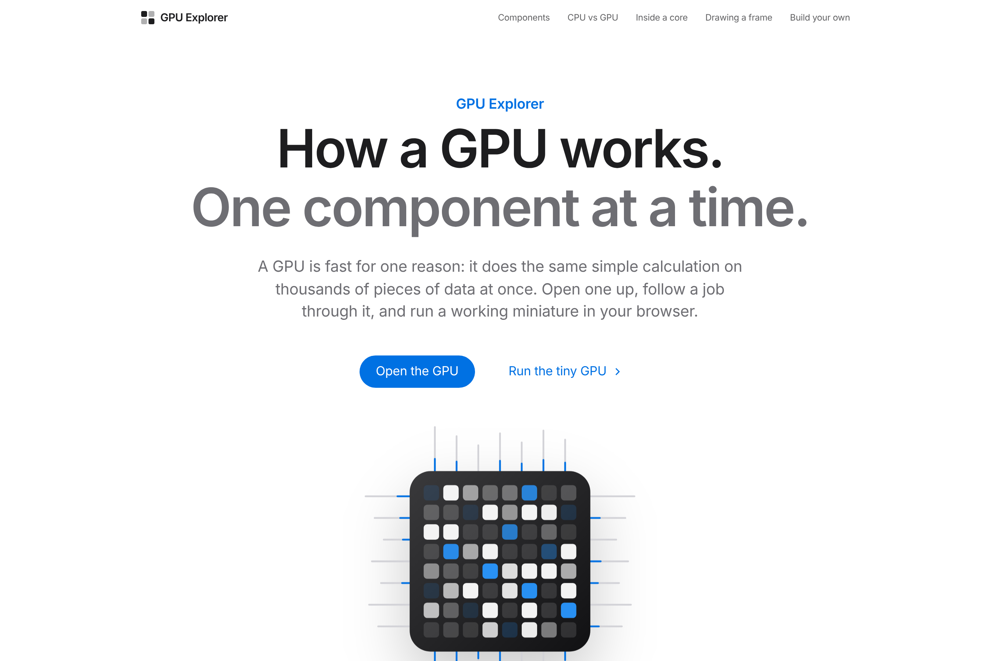

# GPU Explorer

An interactive, animated guide to how a GPU works, written for people with no hardware background.

A GPU is fast for one reason: it does the same simple calculation on thousands of pieces of data at once. This site shows every part that makes that possible and lets you watch them work in the browser.



## What's inside

| Section | What you can do |
| --- | --- |
| **Components** | Click any block of a graphics-card diagram (PCIe, command processor, scheduler, cores, cache, memory controller, VRAM, display engine, power, cooling) to read what it does. A 9-step guided tour follows one job through the card with animated data packets. |
| **CPU vs GPU** | Race 4 fast CPU cores against 16, 64 or 160 simple GPU cores colouring the same image, and see the speed-up. |
| **Inside a core** | Run a working 4-core GPU simulator. Step through fetch, decode and execute, and watch registers and shared memory change. |
| **Drawing a frame** | Watch the graphics pipeline turn three points into a coloured triangle: vertices, vertex shader, assembly, rasterizer, fragment shader, framebuffer. Scrub through any stage. |
| **Build your own** | A short roadmap from logic gates to a tiny GPU on real hardware. |


## Getting started

You need [Node.js](https://nodejs.org) 20 or newer.

```bash
git clone https://github.com/AbhinayAmbati/understand-gpu.git
cd understand-gpu
npm install
npm run dev
```

Open http://localhost:3000.

## Commands

| Command | What it does |
| --- | --- |
| `npm run dev` | Start the development server with live reload |
| `npm run build` | Create a production build |
| `npm run start` | Serve the production build (run `npm run build` first) |
| `npm run lint` | Check the code with ESLint |

## Tech stack

- [Next.js](https://nextjs.org) 16 (App Router) and React 19
- TypeScript
- [Tailwind CSS](https://tailwindcss.com) 4
- [GSAP](https://gsap.com) for scroll, entrance and motion-path animation

There is no backend and no data is collected. Everything runs in the browser.

## Project structure

```
app/
  layout.tsx          Root layout and fonts
  page.tsx            The page: section order, headings and intro text
  globals.css         Design tokens (colours, fonts) and keyframe animations
components/
  SiteHeader.tsx      Sticky nav, scroll progress, current-section highlight
  Hero.tsx            Intro and animated chip
  GpuAnatomy.tsx      Graphics-card diagram, guided tour, detail panel
  CpuVsGpu.tsx        The CPU vs GPU race
  TinyGpuSim.tsx      Interface for the 4-core simulator
  GraphicsPipeline.tsx  Animated triangle pipeline
  Roadmap.tsx         "Build your own" steps
  ui/index.tsx        Shared buttons, segmented control, tiles, scroll reveal
lib/
  parts.ts            Text and positions for every component, and the tour steps
  tinygpu.ts          The simulator itself (pure functions, no UI)
  gsap.ts             GSAP plugin registration
```

## How the tiny GPU works

The simulator in `lib/tinygpu.ts` models four cores that share one program counter and run the same program in lock-step, each on its own data. This is the core idea of a real GPU, at a size you can follow by eye.

Each core has four registers (`R0`–`R3`). Memory holds three lists of four numbers: `A`, `B` (inputs) and `C` (results).

| Instruction | Meaning |
| --- | --- |
| `TID Rd` | Put this core's own number (0–3) into `Rd` |
| `LOAD Rd, X[Rs]` | Read list `X` at the position in `Rs` into `Rd` |
| `STORE X[Rs], Rv` | Write `Rv` into list `X` at the position in `Rs` |
| `ADD Rd, Ra, Rb` | `Rd = Ra + Rb` |
| `MUL Rd, Ra, Rb` | `Rd = Ra × Rb` |
| `ADDI Rd, Ra, n` | `Rd = Ra + n` |
| `DONE` | Stop |

Because every core starts by loading a different number with `TID`, the same program reads and writes a different memory cell on each core. Two programs are included: `C[i] = A[i] + B[i]` and `C[i] = A[i] × B[i] + 10`.

## Customising

- **Change the wording or add a component:** edit `PARTS` in `lib/parts.ts`. Each entry has its text and its position on the diagram.
- **Change the tour:** edit `STEPS` in `lib/parts.ts`. Each step lists the parts to highlight and the path the data packets follow.
- **Add a simulator program:** add an entry to `PROGRAMS` in `lib/tinygpu.ts`.
- **Change colours or fonts:** edit the `@theme` block at the top of `app/globals.css`.

## Accessibility

- Every interactive element works with the keyboard and has a visible focus ring. Use the left and right arrow keys to step through the tour.
- Animations are turned off for visitors who have "reduce motion" set on their device.
- The layout adapts down to phone width.

## A note on accuracy

The diagrams and numbers are simplified for learning. Real GPUs have many more parts and far more cores than shown here.
