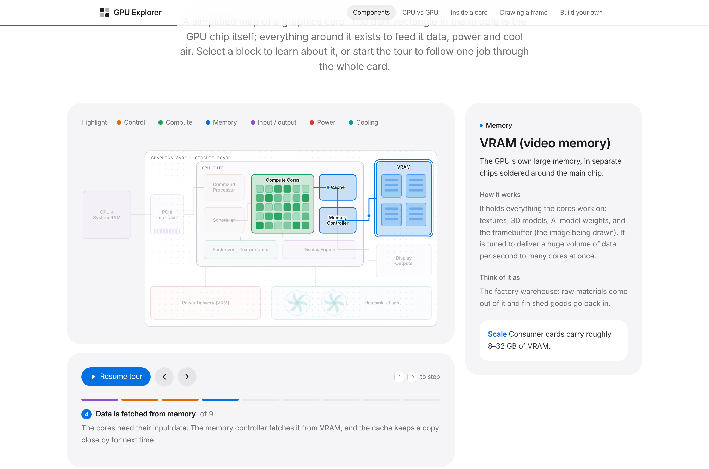

# GPU Explorer

An interactive, animated guide to how a GPU works, written for people with no hardware background.

A GPU is fast for one reason: it does the same simple calculation on thousands of pieces of data at once. This site shows every part that makes that possible and lets you watch them work in the browser.


## What's inside

The site is a short landing page, six chapters (one page each) and a page for every component.

| Page | What you can do |
| --- | --- |
| `/model` — **3D model** | Turn a 3D graphics card, open it up with a slider, click any part to fly to it, and show that part on its own. |
| `/how-it-works` — **How it works** | Click any block of a graphics-card diagram to read what it does. A 9-step guided tour follows one job through the card. |
| `/parallel` — **CPU vs GPU** | Race 4 fast CPU cores against 16, 64 or 160 simple GPU cores colouring the same image. |
| `/core` — **Inside a core** | Run a working 4-core GPU simulator. Step through fetch, decode and execute, and watch registers and memory change. |
| `/pipeline` — **Drawing a frame** | Watch the graphics pipeline turn three points into a coloured triangle, and scrub through any stage. |
| `/build` — **Build your own** | A short roadmap from logic gates to a tiny GPU on real hardware. |
| `/components` and `/components/<part>` | One page per component (PCIe, scheduler, cores, cache, VRAM, power, cooling and more): a focused 3D view, how it works step by step, key figures, a glossary and related parts. |



## Getting started

You need [Node.js](https://nodejs.org) 20 or newer.

```bash
git clone https://github.com/AbhinayAmbati/understand-gpu.git
cd understand-gpu
npm install
npm run dev
```

Open http://localhost:3000.

## Commands

| Command | What it does |
| --- | --- |
| `npm run dev` | Start the development server with live reload |
| `npm run build` | Create a production build |
| `npm run start` | Serve the production build (run `npm run build` first) |
| `npm run lint` | Check the code with ESLint |

## Tech stack

- [Next.js](https://nextjs.org) 16 (App Router) and React 19
- TypeScript
- [Tailwind CSS](https://tailwindcss.com) 4
- [three.js](https://threejs.org) for the 3D model
- [GSAP](https://gsap.com) for scroll, entrance, camera and motion-path animation

There is no backend and no data is collected. Everything runs in the browser.

## Project structure

```
app/
  page.tsx              Landing page
  model/ how-it-works/ parallel/ core/ pipeline/ build/
                        One folder per chapter page
  components/page.tsx   Index of all components
  components/[id]/      One page per component
  globals.css           Design tokens (colours, fonts) and keyframe animations
components/
  Layout.tsx            Page shell, shared container, page intro, chapter navigation
  SiteHeader.tsx        Sticky navigation
  Gpu3D.tsx             The 3D viewer: camera, lighting, shadows, picking, controls
  GpuModelExplorer.tsx  3D chapter: viewer plus the parts panel
  ComponentViewer.tsx   3D view focused on one component
  GpuAnatomy.tsx, CpuVsGpu.tsx, TinyGpuSim.tsx, GraphicsPipeline.tsx, Roadmap.tsx
                        The interactive piece for each chapter
  ui/index.tsx          Shared buttons, segmented control, tiles, scroll reveal
lib/
  chapters.ts           Chapter order, titles and intros
  parts.ts              Every component's name, category, text and tour steps
  details.ts            Long-form content for each component page
  gpu3d.ts              Builds the 3D graphics card with three.js
  tinygpu.ts            The simulator itself (pure functions, no UI)
```

## The 3D model

`lib/gpu3d.ts` builds the card from simple shapes: a printed circuit board with traces and labels, the GPU package with coloured regions for each internal block, VRAM, the power stage, the PCIe connector, the display bracket, and a cooler with curved heat pipes, a fin stack and two fans.

To keep it smooth:

- Static pieces are merged into one mesh per part and material, so the whole card is a few dozen draw calls.
- Frames are drawn only when something changes; the view pauses when it is scrolled out of sight or the tab is hidden.
- Shadows are recalculated only when parts move.
- If frames are consistently slow, the viewer lowers its resolution and then simplifies its shadows.

## How the tiny GPU works

The simulator in `lib/tinygpu.ts` models four cores that share one program counter and run the same program in lock-step, each on its own data. This is the core idea of a real GPU, at a size you can follow by eye.

Each core has four registers (`R0`–`R3`). Memory holds three lists of four numbers: `A`, `B` (inputs) and `C` (results).

| Instruction | Meaning |
| --- | --- |
| `TID Rd` | Put this core's own number (0–3) into `Rd` |
| `LOAD Rd, X[Rs]` | Read list `X` at the position in `Rs` into `Rd` |
| `STORE X[Rs], Rv` | Write `Rv` into list `X` at the position in `Rs` |
| `ADD Rd, Ra, Rb` | `Rd = Ra + Rb` |
| `MUL Rd, Ra, Rb` | `Rd = Ra × Rb` |
| `ADDI Rd, Ra, n` | `Rd = Ra + n` |
| `DONE` | Stop |

Because every core starts by loading a different number with `TID`, the same program reads and writes a different memory cell on each core. Two programs are included: `C[i] = A[i] + B[i]` and `C[i] = A[i] × B[i] + 10`.

## Customising

- **Change the wording or add a component:** edit `PARTS` in `lib/parts.ts`. Each entry has its text and its position on the diagram.
- **Change the tour:** edit `STEPS` in `lib/parts.ts`. Each step lists the parts to highlight and the path the data packets follow.
- **Add a simulator program:** add an entry to `PROGRAMS` in `lib/tinygpu.ts`.
- **Change colours or fonts:** edit the `@theme` block at the top of `app/globals.css`.

## Accessibility

- Every interactive element works with the keyboard and has a visible focus ring. Use the left and right arrow keys to step through the tour.
- Animations are turned off for visitors who have "reduce motion" set on their device.
- The layout adapts down to phone width.

## A note on accuracy

The diagrams and numbers are simplified for learning. Real GPUs have many more parts and far more cores than shown here.
